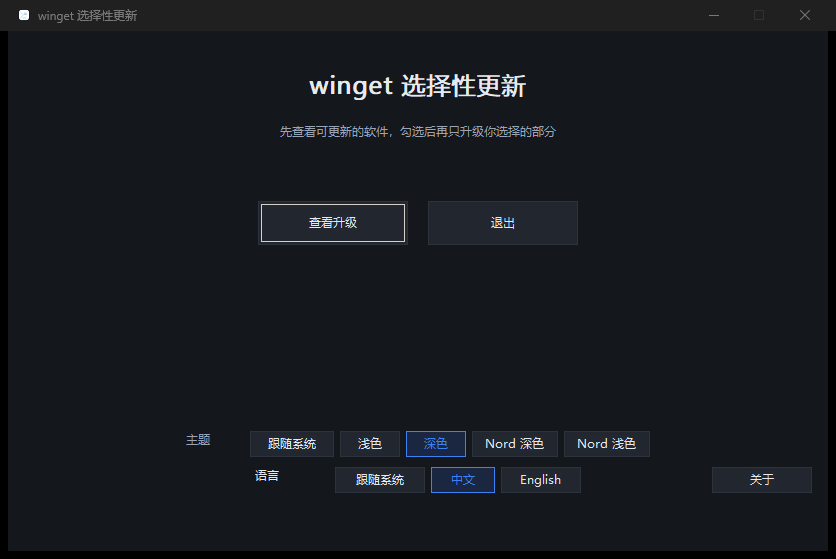
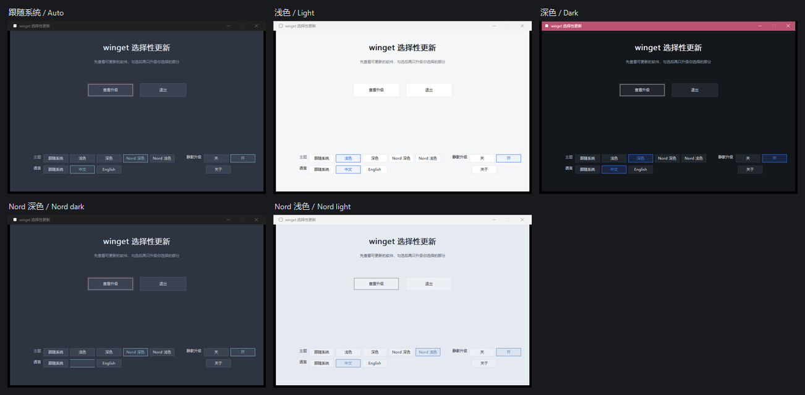
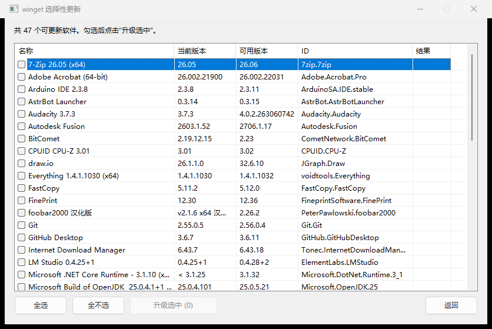
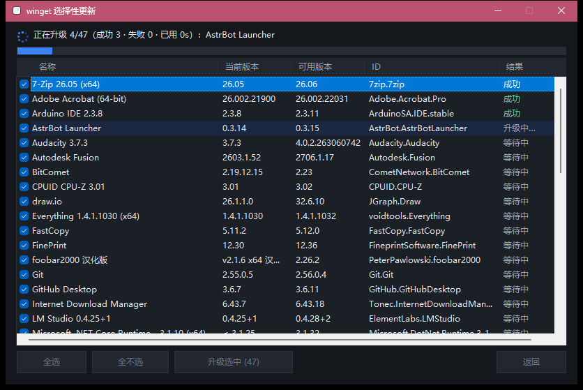
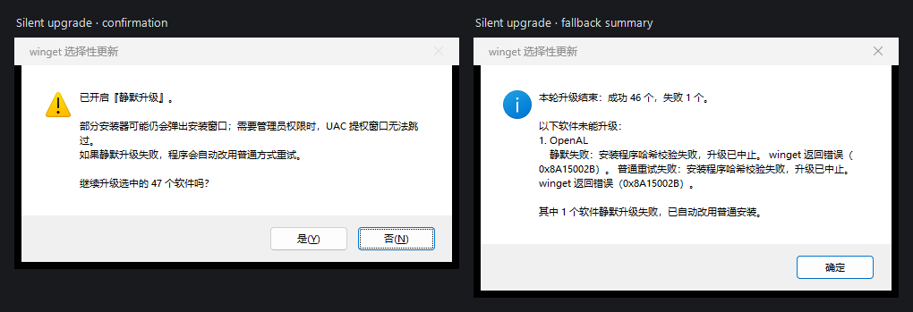

# winget-picker

一个 Windows 小工具：列出 `winget upgrade` 检测到的可更新软件，勾选你想升级的那些，后台逐个升级。

`winget upgrade --all` 会把列表里的程序全部升掉。这个工具把选择权收回来：先看列表，勾你要的，再升级，没勾的软件不会被动到。

Rust 编写，原生 Win32 界面，零第三方依赖。当前版本 0.2.0，发布版约 339 KiB（346,624 字节），双击 `winget-picker.exe` 即可使用。



## 功能

- **选择性升级**：只升级勾选的项目，其余不动。
- **5 套主题**：跟随系统、浅色、深色、Nord 深色、Nord 浅色。选择写入便携 ini，下次启动保持。
- **中英双语**：跟随系统、中文、English。界面、表头、状态栏、错误提示、关于窗都有两套文案。
- **关于窗**：logo、版本号、GitHub 项目地址、MIT 许可。关闭按钮、Esc、Enter 均可关闭。
- **静默升级**（默认关）：开启后先提示风险，升级时追加 `--silent`。静默失败会自动去掉 `--silent` 重试一次，并在汇总里说明回退数量。
- **加载动画**：获取列表和升级过程中，状态栏左侧显示转圈。
- **升级过程可操作**：列表可以滚动、查看；勾选被锁定；当前行高亮；结果列按成功、失败、等待中着色；进度条和已用时间持续刷新。
- **结束汇总**：显示成功/失败数量与失败原因，确认后回到初始界面。


=======
- 语言：Rust（**零第三方依赖**，只有标准库 + 直接调用系统 DLL）
- 界面：原生 Win32
- 体积：**约 278 KB**（`opt-level="z"` + LTO + strip + panic=abort）
- 平台：Windows 10/11（需系统自带 `winget` / 应用安装程序 App Installer）
>>>>>>> cdd1f8e24c65ada017232c9fd4a5dbe239201542

**Code by Deepseek v4.1 Flash (1017)**

## 界面与流程

### 初始界面

只有「查看升级」和「退出」两个主按钮。下方是设置区：

- **主题**：跟随系统 / 浅色 / 深色 / Nord 深色 / Nord 浅色
- **语言**：跟随系统 / 中文 / English
- **静默升级**：关 / 开
- **关于**：打开关于窗

「退出」直接关闭，不执行任何 winget 命令。窗口内按 Tab 切换焦点，按 Enter 激活「查看升级」。

### 列表

「查看升级」在后台执行一次只读列表命令，按名称排序后显示为五列：名称、当前版本、可用版本、ID、结果。



- 点击复选框勾选，也可选中行后按空格，或双击行切换。
- 「全选」/「全不选」批量操作。
- 「升级选中 (N)」开始升级；「返回」或 Esc 回到初始界面。
- 升级期间勾选锁定，防止中途误改范围；列表本身仍可浏览。

### 升级中

状态栏显示进度和当前软件名，左侧有转圈动画，下方是进度条。



- 当前正在升级的行以高亮背景标出，并自动滚入可视区。
- 结果列：成功显示绿色，失败红色，等待中的项目灰色。
- 已用时间按秒刷新，便于判断某个包是否卡住。
- 全部结束后弹出汇总；关闭汇总自动回到初始界面。

## 静默升级

默认关闭。开启后点击「升级选中」会先弹出确认框，说明三件事：

- 部分安装器即使加了 `--silent` 仍可能弹窗。
- 需要管理员权限时，UAC 提权窗口无法跳过。
- 静默升级失败会自动改用普通方式重试。

确认后，每个包的升级命令追加 `--silent`。如果某个包静默失败，程序会去掉 `--silent` 再执行一次普通升级：

- 回退成功：计入成功，状态栏显示「静默失败，改用普通方式重试…」，汇总里写明有几个包走了回退。
- 回退也失败：计入失败，失败详情同时包含静默和普通两次的错误。



## 配置

程序使用便携 ini，查找顺序：

1. 环境变量 `WINGET_PICKER_INI` 指定的路径
2. exe 同目录的 `winget-picker.ini`（目录可写时）
3. `%LOCALAPPDATA%\winget-picker\winget-picker.ini`

ini 内容示例：

```ini
theme=auto
lang=auto
silent=0
```

- `theme`：`auto` / `light` / `dark` / `nord` / `nord-light`
- `lang`：`auto` / `zh` / `en`
- `silent`：`0` / `1`

环境变量可以临时覆盖（不写盘）：`WINGET_PICKER_THEME`、`WINGET_PICKER_LANG`、`WINGET_PICKER_SILENT`、`WINGET_PICKER_NO_SAVE`。

## 运行

1. 双击 `winget-picker.exe`。
2. 放在桌面或其他普通目录均可。
3. Windows 10/11，需要系统自带的 `winget`（应用安装程序 App Installer）。

如果从受限目录（某些沙箱或同步盘）启动，winget 的 AppX 执行别名可能拒绝激活。换到普通目录运行即可。

程序自身不联网、不收集数据。升级时的网络访问由 winget 完成。

## 构建

需要 Rust 工具链（MSVC target）：

```powershell
cd winget-picker
cargo build --release
# 产物：target\release\winget-picker.exe
```

`Cargo.toml` 的 release 配置：

```toml
[profile.release]
opt-level = "z"
lto = true
codegen-units = 1
panic = "abort"
strip = true
```

`build.rs` 会把 `app.manifest` 嵌入 exe（Common Controls v6 视觉样式、DPI 感知、Windows 10/11 兼容声明），并在能找到 `rc.exe` 时编译 `assets/app.rc`，写入图标和版本资源。找不到 `rc.exe` 时跳过资源编译，程序仍可构建运行。

## 测试

解析单元测试：

```powershell
cargo test --release
```

当前 6 个测试全部通过，覆盖真实中文 winget 输出和合成中英文表格。

GUI 自动化测试使用 `fake-winget/` 里的假 winget，不触碰真实软件。先编译假 winget：

```powershell
rustc -O -o fake-winget\winget.exe fake-winget\fake_winget.rs
```

测试脚本：

| 脚本 | 验证内容 |
|---|---|
| `tools/gui_test.ps1` | 假 winget 完整流程：列表、勾选、升级、汇总、返回 |
| `tools/gui_test_progress.ps1` | 升级中列表可滚动、勾选锁定、自动跟随、结果着色 |
| `tools/gui_test_theme.ps1` | 5 套主题、暗色列表、ini 持久化 |
| `tools/gui_test_i18n.ps1` | 中英切换、标题、英文列表与升级状态、重启保持 |
| `tools/gui_test_about.ps1` | 关于窗渲染、Esc/Enter/关闭按钮、模态行为 |
| `tools/gui_test_silent.ps1` | 静默提示、`--silent` 参数、失败回退、汇总、持久化 |
| `tools/gui_test_spinner.ps1` | 加载与升级中的转圈可见且两帧有变化 |
| `tools/gui_verify.ps1` | 真实 winget 的列表加载与界面验证（只读，不升级） |

GUI 测试需要把 exe 放在普通目录运行，避免受限目录影响 winget 激活。

## 实现要点

- **纯 Win32 GUI**：窗口、ListView、按钮、状态栏、进度条、关于窗都是原生控件或自绘，没有 GUI 框架。
- **自绘控件**：主题分段按钮、复选框状态图、表头、列表分隔线、暗色标题栏、加载转圈。深色模式下滚动条仍是系统样式。
- **表格解析**：以分隔行定位表头，按显示列宽切分单元格（中文按 2 列），兼容中英文 winget 输出、名称含空格、末列较短、统计行结尾等情况。
- **后台执行**：列表和升级都在工作线程中进行，主线程只处理 UI 消息；winget 输出用并发读管道，避免管道写满导致卡死。
- **超时与兜底**：列表获取有 120 秒超时；直接启动 winget 失败且没有输出时，会改用 `cmd.exe` 中转并重定向到临时文件重试一次。
- **零依赖**：`Cargo.lock` 中没有第三方 crate。

## 文件结构

```
winget-picker/
├── Cargo.toml / Cargo.lock
├── build.rs                # 嵌入 manifest；可选编译图标/版本资源
├── app.manifest            # 视觉样式、DPI、系统兼容声明
├── assets/
│   ├── app.ico             # 7 个尺寸的应用图标
│   ├── app.rc              # 图标 + VERSIONINFO
│   └── logo-256.png        # 关于窗/预览用 logo
├── src/
│   ├── main.rs             # Win32 GUI、流程、winget 调用、表格解析
│   ├── theme.rs            # 5 套主题与系统深色检测
│   ├── lang.rs             # 中英文案
│   └── config.rs           # 便携 ini 与环境变量
├── testdata/
│   └── winget_upgrade_zh.txt
├── fake-winget/            # 测试用假 winget
├── tools/                  # GUI 自动化测试脚本
├── screens/                # 假 winget 全流程截图
├── screens-real/           # 真实 winget 截图
├── screens-progress/       # 升级中 UI 截图
├── screens-themes/         # 主题/语言/关于/静默/转圈截图
├── docs/                   # 版本计划与离线错误记录
├── wingetpicker.svg        # 图标设计源文件
├── LICENSE
└── README.md
```

## 已验证内容

- **真实 winget**：从桌面运行 `winget-picker.exe`，成功列出本机 24 个可更新软件，返回初始界面和关闭窗口正常（`screens-real/`）。
- **完整升级流程**：用假 winget 模拟 47 个软件，全选升级，调用次数、进度、结果标记、失败汇总、回到初始界面均符合预期（`screens/`）。
- **升级中 UI**：列表滚动、勾选锁定、自动跟随、结果着色、进度条与计时正常（`screens-progress/`）。
- **主题与语言**：5 套主题渲染、暗色列表与复选框、ini 持久化、中英切换和重启保持均通过（`screens-themes/`）。
- **关于窗**：中英/深浅 theme 截图，Esc、Enter、关闭按钮、模态禁用/恢复均通过。
- **静默升级**：确认框出现；47 次带 `--silent` 的升级调用；2 次普通回退（Git.Git 静默失败后成功、OpenAL 两次都失败）；汇总含回退数量；关闭静默升级时，升级调用不带 `--silent`；`silent=1` 写入 ini。
- **加载转圈**：加载和升级两个阶段均可见，两帧之间有变化；列表就绪后隐藏。
- **退出按钮**：点击后立即退出，不启动 winget 进程。

真实升级未在测试中执行，避免未经许可改动本机软件。升级命令的构造、参数和调用由假 winget 验证。

## 已知限制

- `winget upgrade` 的表格格式若变化，解析器需要同步调整。
- 需要管理员权限的安装包会弹 UAC，无法跳过。
- 静默升级不保证安装器完全无窗口，部分安装器仍会弹出自己的界面。
- 升级过程中关闭窗口会确认一次；已经启动的 winget 子进程可能继续在后台完成。
- 断网或 winget/msstore 报错时，目前直接展示 winget 原始错误（含错误码，部分文字可能乱码），尚未做本地化友好提示。

## 更新记录

- **0.2.0**（2026-11-26）：主题系统（5 套）、中英文切换、关于窗、静默升级（提示与自动回退）、加载转圈、应用图标与版本资源；设置区改为 2×2 布局、所有设置按钮统一 80×26、标签右对齐；列表页底部动作按钮统一 150×32；修复主题切换后底部控件不重绘、升级结束返回主界面转圈残留。
- **0.1.x**：选择性升级、列表解析、升级过程 UI（滚动、勾选锁定、进度条、结果着色、汇总）。

## 致谢

Code by Deepseek v4.1 Flash (1017)

项目主页与问题反馈：<https://github.com/lattemint/winget-picker/issue>

## License

MIT License © 2026 LatteMint
